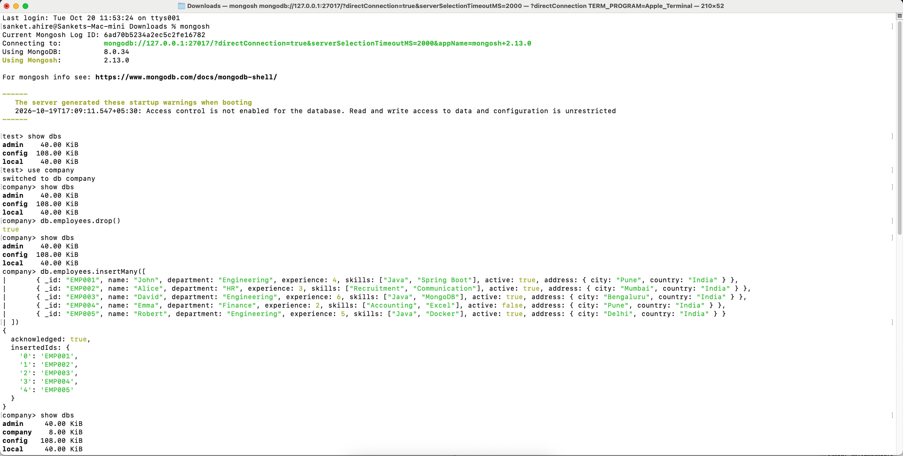
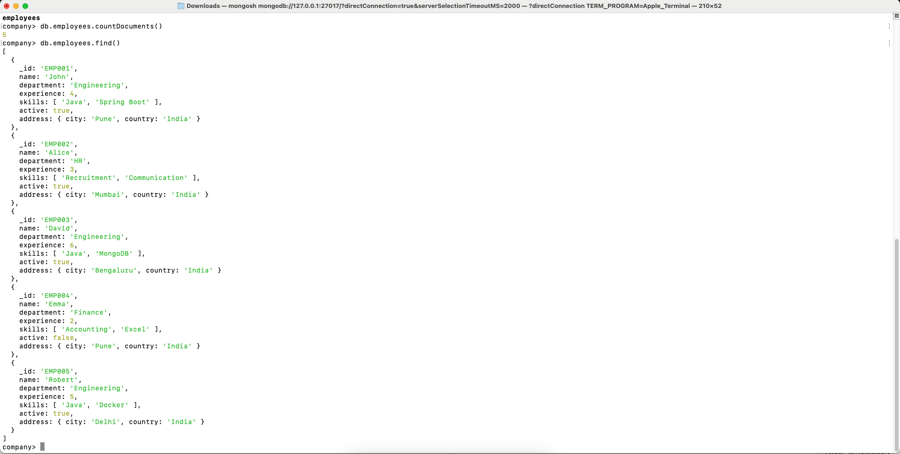
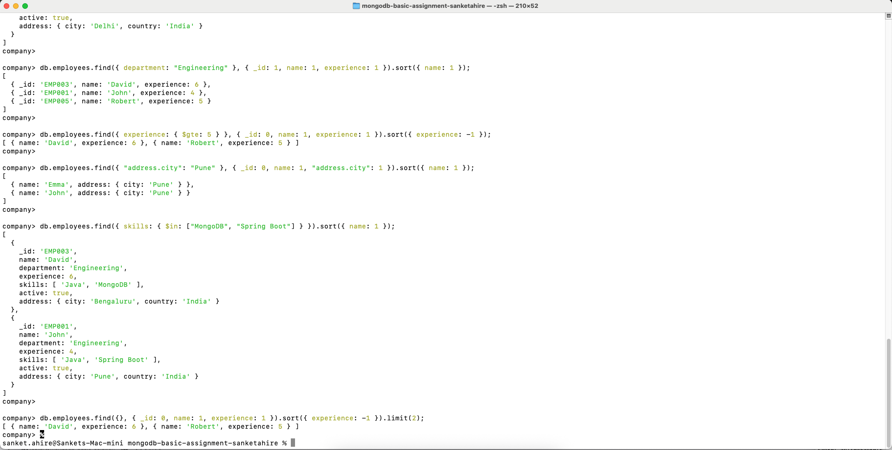
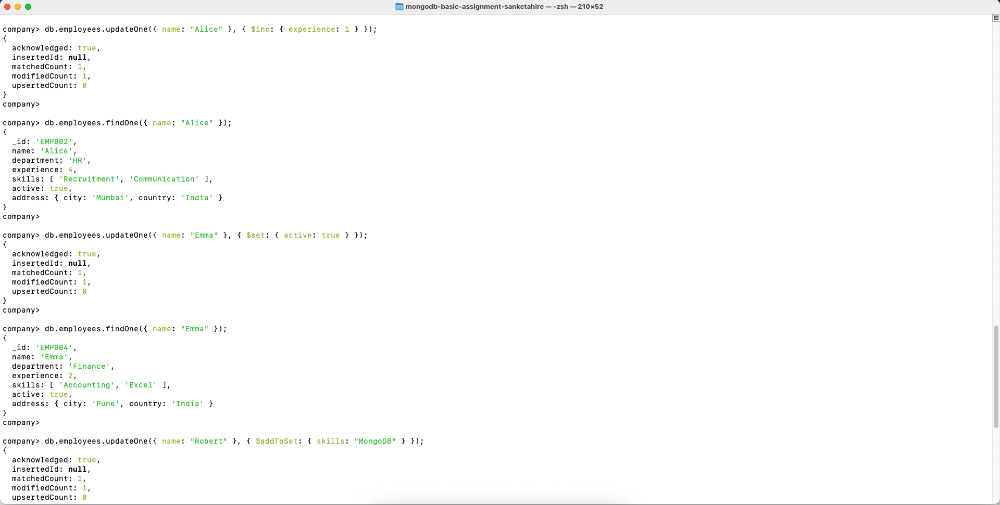
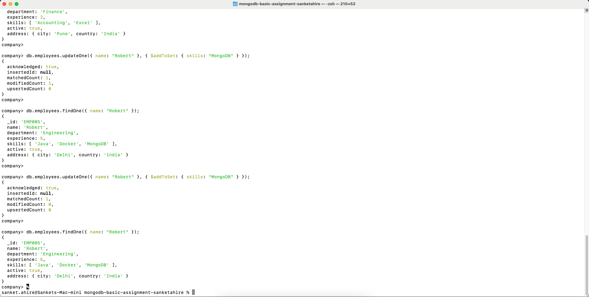
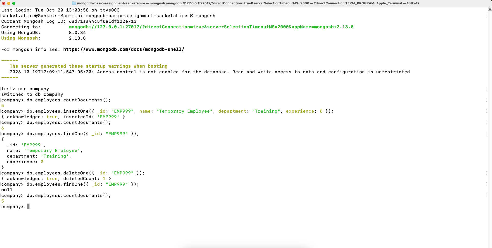
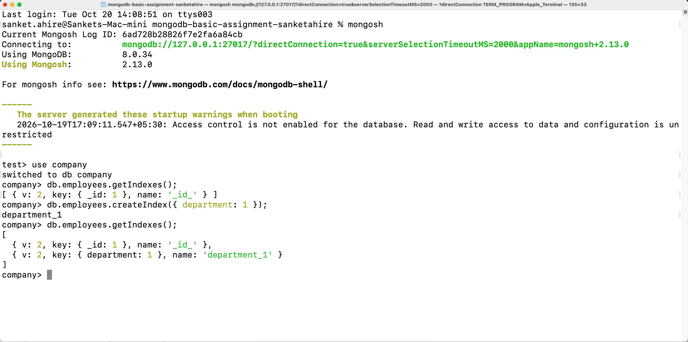
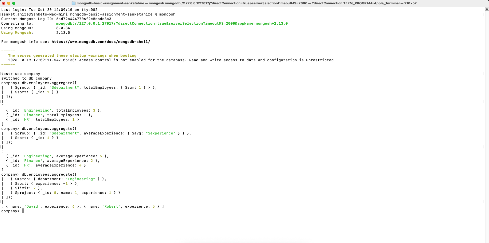

# MongoDB Basic Training Assignment

A comprehensive implementation of core MongoDB fundamentals, CRUD operations, indexing strategies, and aggregation pipelines using `mongosh`.

## Overview
This repository contains the completed assignment for the **MongoDB (Basic)** training module. The objective is to demonstrate proficiency in:
- Local database setup and collection lifecycle management
- Document-based CRUD operations with field-level projections and sorting
- Query operators (comparison, logical, element, array, and nested document queries)
- Atomic update operators (`$inc`, `$set`, `$addToSet`) and canary deletions
- Single-field indexing and query plan verification
- Multi-stage aggregation pipelines (`$match`, `$group`, `$sort`, `$limit`, `$project`)
- Schema design principles and MongoDB security best practices

## Environment & Prerequisites
- **Database Engine:** MongoDB Community Server (v6.0+)
- **Shell Interface:** MongoDB Shell (`mongosh`)
- **Node.js / JavaScript Runtime:** v18+ (optional, for script execution)

## Repository Structure
```
mongodb-basic-assignment-sanketahire/
├── .gitignore                     # Ignored operating system and log artifacts
├── README.md                      # Project documentation and execution guide
├── mongodb-basic-assignment.js    # Primary solution script for Tasks 1–6
├── answers.md                     # Assessment answers for Task 7 (MCQs)
├── screenshots/                   # Visual proof of successful execution
└── docs/                          # Assignment specifications and reference materials
    ├── Training.Assignment.Mongodb (Basic).pdf
    └── Training.Material.Mongdb (Basic),.pdf
```

## Solution Delivery
The full assignment solution, queries, outputs, and visual execution artifacts are implemented in the `feature/mongodb-basic-solution` branch and submitted via Pull Request.

---

## Task-by-Task Implementation & Verification

### Task 1: Local Setup and Data Creation

#### Step 1: Switch to Database
⚡ **Input Command:**
```javascript
use company;
```
🖥️ **Terminal Output:**
```text
switched to db company
```

#### Step 2: Verify Connection & List Databases
⚡ **Input Command:**
```javascript
show dbs;
```
🖥️ **Terminal Output:**
```text
admin     40.00 KiB
config   108.00 KiB
local     40.00 KiB
```

#### Step 3: Clean Slate Reset
⚡ **Input Command:**
```javascript
db.employees.drop();
```
🖥️ **Terminal Output:**
```text
true
```

#### Step 4: Insert the Seed Dataset (5 Employees)
⚡ **Input Command:**
```javascript
db.employees.insertMany([
  { _id: "EMP001", name: "John", department: "Engineering", experience: 4, skills: ["Java", "Spring Boot"], active: true, address: { city: "Pune", country: "India" } },
  { _id: "EMP002", name: "Alice", department: "HR", experience: 3, skills: ["Recruitment", "Communication"], active: true, address: { city: "Mumbai", country: "India" } },
  { _id: "EMP003", name: "David", department: "Engineering", experience: 6, skills: ["Java", "MongoDB"], active: true, address: { city: "Bengaluru", country: "India" } },
  { _id: "EMP004", name: "Emma", department: "Finance", experience: 2, skills: ["Accounting", "Excel"], active: false, address: { city: "Pune", country: "India" } },
  { _id: "EMP005", name: "Robert", department: "Engineering", experience: 5, skills: ["Java", "Docker"], active: true, address: { city: "Delhi", country: "India" } }
]);
```
🖥️ **Terminal Output:**
```json
{
  "acknowledged": true,
  "insertedIds": {
    "0": "EMP001",
    "1": "EMP002",
    "2": "EMP003",
    "3": "EMP004",
    "4": "EMP005"
  }
}
```

#### Step 5: Verify Collection Exists
⚡ **Input Command:**
```javascript
show collections;
```
🖥️ **Terminal Output:**
```text
employees
```

#### Step 6: Verify Total Document Count
⚡ **Input Command:**
```javascript
db.employees.countDocuments();
```
🖥️ **Terminal Output:**
```text
5
```

#### Step 7: View Seeded Documents
⚡ **Input Command:**
```javascript
db.employees.find();
```
🖥️ **Terminal Output:**
```json
[
  {
    "_id": "EMP001",
    "name": "John",
    "department": "Engineering",
    "experience": 4,
    "skills": ["Java", "Spring Boot"],
    "active": true,
    "address": { "city": "Pune", "country": "India" }
  },
  {
    "_id": "EMP002",
    "name": "Alice",
    "department": "HR",
    "experience": 3,
    "skills": ["Recruitment", "Communication"],
    "active": true,
    "address": { "city": "Mumbai", "country": "India" }
  },
  {
    "_id": "EMP003",
    "name": "David",
    "department": "Engineering",
    "experience": 6,
    "skills": ["Java", "MongoDB"],
    "active": true,
    "address": { "city": "Bengaluru", "country": "India" }
  },
  {
    "_id": "EMP004",
    "name": "Emma",
    "department": "Finance",
    "experience": 2,
    "skills": ["Accounting", "Excel"],
    "active": false,
    "address": { "city": "Pune", "country": "India" }
  },
  {
    "_id": "EMP005",
    "name": "Robert",
    "department": "Engineering",
    "experience": 5,
    "skills": ["Java", "Docker"],
    "active": true,
    "address": { "city": "Delhi", "country": "India" }
  }
]
```

#### Visual Execution Proof:
* **Setup, Database Selection & Seed Insertion:**  
  
* **Collection & Count Verification:**  
  

---

### Task 2: Read and Query Operations

#### 2.1 Engineering Employees
Retrieve employees whose department is Engineering. Return only `_id`, `name`, and `experience`, sorted by `name` in ascending order.

⚡ **Input Command:**
```javascript
db.employees.find({ department: "Engineering" }, { _id: 1, name: 1, experience: 1 }).sort({ name: 1 });
```
🖥️ **Terminal Output:**
```json
[
  { "_id": "EMP003", "name": "David", "experience": 6 },
  { "_id": "EMP001", "name": "John", "experience": 4 },
  { "_id": "EMP005", "name": "Robert", "experience": 5 }
]
```

#### 2.2 Employees with 5 or More Years of Experience
Retrieve employees whose experience is greater than or equal to 5. Return only `name` and `experience`, excluding `_id`, sorted by `experience` in descending order.

⚡ **Input Command:**
```javascript
db.employees.find({ experience: { $gte: 5 } }, { _id: 0, name: 1, experience: 1 }).sort({ experience: -1 });
```
🖥️ **Terminal Output:**
```json
[
  { "name": "David", "experience": 6 },
  { "name": "Robert", "experience": 5 }
]
```

#### 2.3 Nested Document Query (City: Pune)
Retrieve employees whose address city is Pune. Return only employee name and city, sorted by `name` in ascending order.

⚡ **Input Command:**
```javascript
db.employees.find({ "address.city": "Pune" }, { _id: 0, name: 1, "address.city": 1 }).sort({ name: 1 });
```
🖥️ **Terminal Output:**
```json
[
  { "name": "Emma", "address": { "city": "Pune" } },
  { "name": "John", "address": { "city": "Pune" } }
]
```

#### 2.4 Array Query with `$in` (MongoDB or Spring Boot)
Using `$in`, retrieve employees whose skills contain either MongoDB or Spring Boot, sorted by `name` in ascending order.

⚡ **Input Command:**
```javascript
db.employees.find({ skills: { $in: ["MongoDB", "Spring Boot"] } }).sort({ name: 1 });
```
🖥️ **Terminal Output:**
```json
[
  {
    "_id": "EMP003",
    "name": "David",
    "department": "Engineering",
    "experience": 6,
    "skills": ["Java", "MongoDB"],
    "active": true,
    "address": { "city": "Bengaluru", "country": "India" }
  },
  {
    "_id": "EMP001",
    "name": "John",
    "department": "Engineering",
    "experience": 4,
    "skills": ["Java", "Spring Boot"],
    "active": true,
    "address": { "city": "Pune", "country": "India" }
  }
]
```

#### 2.5 Sorting and Limiting (Top 2 Highest Experience)
Retrieve the top 2 employees with the highest experience. Return only `name` and `experience`.

⚡ **Input Command:**
```javascript
db.employees.find({}, { _id: 0, name: 1, experience: 1 }).sort({ experience: -1 }).limit(2);
```
🖥️ **Terminal Output:**
```json
[
  { "name": "David", "experience": 6 },
  { "name": "Robert", "experience": 5 }
]
```

#### Visual Execution Proof:
* **Query and Read Operations:**  
  

---

### Task 3: Update Operations

#### 3.1 Atomic Increment with `$inc` (Alice's Experience)
Increase Alice's experience by 1 (advances from 3 to 4).

⚡ **Input Command:**
```javascript
db.employees.updateOne({ name: "Alice" }, { $inc: { experience: 1 } });
```
🖥️ **Terminal Output:**
```json
{
  "acknowledged": true,
  "insertedId": null,
  "matchedCount": 1,
  "modifiedCount": 1,
  "upsertedCount": 0
}
```

**Verification:**
⚡ **Input Command:**
```javascript
db.employees.findOne({ name: "Alice" });
```
🖥️ **Terminal Output:**
```json
{
  "_id": "EMP002",
  "name": "Alice",
  "department": "HR",
  "experience": 4,
  "skills": ["Recruitment", "Communication"],
  "active": true,
  "address": { "city": "Mumbai", "country": "India" }
}
```

#### 3.2 Field Update with `$set` (Emma's Active Status)
Change Emma's active value from `false` to `true`.

⚡ **Input Command:**
```javascript
db.employees.updateOne({ name: "Emma" }, { $set: { active: true } });
```
🖥️ **Terminal Output:**
```json
{
  "acknowledged": true,
  "insertedId": null,
  "matchedCount": 1,
  "modifiedCount": 1,
  "upsertedCount": 0
}
```

**Verification:**
⚡ **Input Command:**
```javascript
db.employees.findOne({ name: "Emma" });
```
🖥️ **Terminal Output:**
```json
{
  "_id": "EMP004",
  "name": "Emma",
  "department": "Finance",
  "experience": 2,
  "skills": ["Accounting", "Excel"],
  "active": true,
  "address": { "city": "Pune", "country": "India" }
}
```

#### 3.3 Array Update with `$addToSet` (Robert's Skills)
Add `"MongoDB"` to Robert's skills array using `$addToSet`.

⚡ **Input Command:**
```javascript
db.employees.updateOne({ name: "Robert" }, { $addToSet: { skills: "MongoDB" } });
```
🖥️ **Terminal Output:**
```json
{
  "acknowledged": true,
  "insertedId": null,
  "matchedCount": 1,
  "modifiedCount": 1,
  "upsertedCount": 0
}
```

**Verification:**
⚡ **Input Command:**
```javascript
db.employees.findOne({ name: "Robert" });
```
🖥️ **Terminal Output:**
```json
{
  "_id": "EMP005",
  "name": "Robert",
  "department": "Engineering",
  "experience": 5,
  "skills": ["Java", "Docker", "MongoDB"],
  "active": true,
  "address": { "city": "Delhi", "country": "India" }
}
```

#### 3.3 Idempotency Proof (Executing `$addToSet` a Second Time)
Execute the exact same `$addToSet` operation again and verify that `"MongoDB"` is not duplicated (`modifiedCount: 0`).

⚡ **Input Command:**
```javascript
db.employees.updateOne({ name: "Robert" }, { $addToSet: { skills: "MongoDB" } });
```
🖥️ **Terminal Output:**
```json
{
  "acknowledged": true,
  "insertedId": null,
  "matchedCount": 1,
  "modifiedCount": 0,
  "upsertedCount": 0
}
```

**Verification:**
⚡ **Input Command:**
```javascript
db.employees.findOne({ name: "Robert" });
```
🖥️ **Terminal Output:**
```json
{
  "_id": "EMP005",
  "name": "Robert",
  "department": "Engineering",
  "experience": 5,
  "skills": ["Java", "Docker", "MongoDB"],
  "active": true,
  "address": { "city": "Delhi", "country": "India" }
}
```

#### Visual Execution Proof:
* **Update Operations (Alice, Emma, Robert):**  
  
* **Idempotency Verification ($addToSet Second Execution):**  
  

---

### Task 4: Delete Operation

#### Step 1: Baseline Count Verification
Assert the starting collection document count prior to insertion.

⚡ **Input Command:**
```javascript
db.employees.countDocuments();
```
🖥️ **Terminal Output:**
```text
5
```

#### Step 2: Insert Temporary Canary Document (`EMP999`)
Insert a temporary employee record into the collection.

⚡ **Input Command:**
```javascript
db.employees.insertOne({ _id: "EMP999", name: "Temporary Employee", department: "Training", experience: 0 });
```
🖥️ **Terminal Output:**
```json
{
  "acknowledged": true,
  "insertedId": "EMP999"
}
```

#### Step 3: Verify Count After Insertion
Assert that document count increased from 5 to 6.

⚡ **Input Command:**
```javascript
db.employees.countDocuments();
```
🖥️ **Terminal Output:**
```text
6
```

#### Step 4: Verify Canary Document Exists
Verify that `EMP999` is retrieved properly.

⚡ **Input Command:**
```javascript
db.employees.findOne({ _id: "EMP999" });
```
🖥️ **Terminal Output:**
```json
{
  "_id": "EMP999",
  "name": "Temporary Employee",
  "department": "Training",
  "experience": 0
}
```

#### Step 5: Delete Only the Canary Document
Delete only the temporary record using `deleteOne()`.

⚡ **Input Command:**
```javascript
db.employees.deleteOne({ _id: "EMP999" });
```
🖥️ **Terminal Output:**
```json
{
  "acknowledged": true,
  "deletedCount": 1
}
```

#### Step 6: Verification of Targeted Deletion
Assert that querying for `EMP999` returns `null`.

⚡ **Input Command:**
```javascript
db.employees.findOne({ _id: "EMP999" });
```
🖥️ **Terminal Output:**
```text
null
```

#### Step 7: Collection Integrity Check
Assert that the original 5 employee documents remain intact in the collection.

⚡ **Input Command:**
```javascript
db.employees.countDocuments();
```
🖥️ **Terminal Output:**
```text
5
```

#### Visual Execution Proof:
* **Canary Document Insertion, Deletion & Integrity Check:**  
  

---

### Task 5: Indexing Strategy

#### Step 1: Baseline Index Inspection
Inspect existing indexes on the `employees` collection prior to creating custom indexes (default `_id_` index created by MongoDB).

⚡ **Input Command:**
```javascript
db.employees.getIndexes();
```
🖥️ **Terminal Output:**
```json
[
  {
    "v": 2,
    "key": {
      "_id": 1
    },
    "name": "_id_"
  }
]
```

#### Step 2: Create Ascending Index on `department`
Create a single-field index on the `department` field in ascending order (`1`) to optimize department-based filtering and grouping.

⚡ **Input Command:**
```javascript
db.employees.createIndex({ department: 1 });
```
🖥️ **Terminal Output:**
```text
department_1
```

#### Step 3: Verification of Created Index
Assert that `getIndexes()` now returns both the default primary key index `_id_` and the newly created `department_1` index.

⚡ **Input Command:**
```javascript
db.employees.getIndexes();
```
🖥️ **Terminal Output:**
```json
[
  {
    "v": 2,
    "key": {
      "_id": 1
    },
    "name": "_id_"
  },
  {
    "v": 2,
    "key": {
      "department": 1
    },
    "name": "department_1"
  }
]
```

#### Visual Execution Proof:
* **Single-Field Department Index Verification:**  
  

---

### Task 6: Aggregation Pipelines

#### Step 1: Count Employees in Each Department
Group documents by the `department` field and calculate the total employee count per department using `$group` with `$sum: 1`, sorted alphabetically by department name (`{ _id: 1 }`).

⚡ **Input Command:**
```javascript
db.employees.aggregate([
  { $group: { _id: "$department", totalEmployees: { $sum: 1 } } },
  { $sort: { _id: 1 } }
]);
```
🖥️ **Terminal Output:**
```json
[
  { "_id": "Engineering", "totalEmployees": 3 },
  { "_id": "Finance", "totalEmployees": 1 },
  { "_id": "HR", "totalEmployees": 1 }
]
```

#### Step 2: Calculate Average Experience per Department
Calculate the average experience of employees in each department using `$group` with `$avg: "$experience"`, sorted alphabetically by department name (`{ _id: 1 }`).

⚡ **Input Command:**
```javascript
db.employees.aggregate([
  { $group: { _id: "$department", averageExperience: { $avg: "$experience" } } },
  { $sort: { _id: 1 } }
]);
```
🖥️ **Terminal Output:**
```json
[
  { "_id": "Engineering", "averageExperience": 5 },
  { "_id": "Finance", "averageExperience": 2 },
  { "_id": "HR", "averageExperience": 4 }
]
```

#### Step 3: Top 2 Highest-Experience Employees in Engineering
Find the top 2 employees with the highest experience in the `Engineering` department by chaining `$match` (filter `department: "Engineering"`), `$sort` (descending experience `{ experience: -1 }`), `$limit` (`2`), and `$project` (`_id: 0, name: 1, experience: 1`).

⚡ **Input Command:**
```javascript
db.employees.aggregate([
  { $match: { department: "Engineering" } },
  { $sort: { experience: -1 } },
  { $limit: 2 },
  { $project: { _id: 0, name: 1, experience: 1 } }
]);
```
🖥️ **Terminal Output:**
```json
[
  { "name": "David", "experience": 6 },
  { "name": "Robert", "experience": 5 }
]
```

#### Visual Execution Proof:
* **Aggregation Pipelines (Group Count, Average Experience, Top Engineers):**  
  

